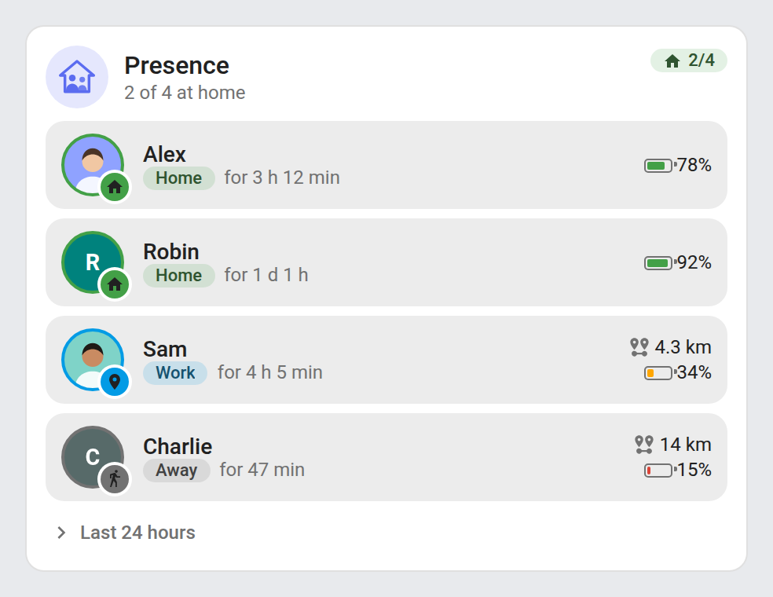
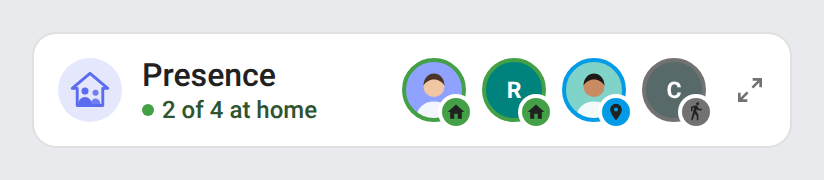

# Changelog

## 1.10.0 - 2026-11-09

### Performance
- **Translations load on demand**: the bundle keeps English only (94 KB → 65 KB) and each other language is its own `presence-card.i18n.<lang>.js` file next to it, fetched the first time a card needs it. Home Assistant loads every dashboard resource on every dashboard, so each page used to download and parse all 22 languages to use one. Until a language file has arrived (a few milliseconds), texts fall back to English, and the cards redraw once it is there.

### Maintenance
- Build: `scripts/i18n-split.mjs` splits the built bundle and rebuilds every table from the split files to check them (the build fails on any difference); `src/` keeps every language as before.
- Release: every file of `dist/` is attached. Manual installation copies the translation files too.

## 1.9.0 - 2026-11-08

### What's new
- Distances are written in the number format of the card's language (decimal separator, thousands, unit).
- Dates, times and distances keep the region of the Home Assistant profile (pt-BR, en-GB, fr-CA…), and Portuguese uses European Portuguese formats.
- In a Home Assistant language the card does not translate (Japanese, Finnish, Turkish…), dates, times and distances keep that language's formats; only the texts are in English.
- Without any Proximity sensor in the entity registry, the card no longer searches the states for them at each update.

## 1.8.0 - 2026-11-07

### What's new
- **Last 24 hours**: the movement times follow the 12 / 24 hour clock of the Home Assistant profile and the card's language.
- The header logo's label for screen readers is translated in the 22 languages.

### Fixes
- **Last 24 hours**: movements older than 24 hours no longer stay in the list when nobody has moved since; the history is also read again each hour.
- A person whose state is unknown or unavailable no longer shows a distance (or direction of travel) from their last known position.

## 1.7.0 - 2026-11-07

### What's new
- **Proximity**: for a person away who has sensors of the core Proximity integration, the row shows the direction of travel (arriving, leaving or stationary) as an icon next to the distance, which then comes from the Proximity sensor.
- The Proximity sensors are found automatically in the entity registry (any language), or set per person with `proximity_direction` and `proximity_distance`.
- `show_direction: false` (visual editor) hides the direction of travel; the mini card adds it to each avatar's tooltip. Translated in the 22 languages.

## 1.6.1 - 2026-11-07

### Fixes
- **Last 24 hours**: a person who was in a zone when the 24 hours began and then left it now shows as "left <zone>", not "left home". The movements are read from the history, with each person's state at the start of the window.

## 1.6.0 - 2026-11-07

### What's new
- **Last 24 hours**: a folded section under the people of the full card (and of the mini card zoomed in) lists their movements — arrived home, left home, arrived at a zone, left a zone — newest first with the time (the day for yesterday's), read from the logbook when unfolded and again once someone moves. Chevron right folded, down unfolded, folds back on a click elsewhere; a click on a movement opens the person. `show_moves: false` (visual editor) removes it. Translated in the 22 languages.

## 1.5.10 - 2026-11-04

### Documentation
- README: images and links use absolute URLs, so the screenshots, icons, badges and links display in HACS (relative paths broke there).
- README: screenshots get a display size, so cards no longer show oversized in HACS and on GitHub.

## 1.5.9 - 2026-11-04
### Added
- Added Romanian, Danish, Swedish, Bulgarian, Russian, Ukrainian, Hungarian, Slovak, Czech, Slovenian, Latvian and Greek translations (`ro`, `da`, `sv`, `bg`, `ru`, `uk`, `hu`, `sk`, `cs`, `sl`, `lv`, `el`), also offered in the visual editor's language list.

## 1.5.8 - 2026-11-02
### Fixed
- Mini cards: the header icon keeps its full size (40 px) in the compact view, like the full card.

## 1.5.7 - 2026-11-01
### Fixed
- A configured person that no longer exists (deleted or renamed) no longer replaces the whole card with a warning: the other people stay shown, with the header and the count, and a "Person not found" line is added for each missing one. This applies to the mini card too.
- A long zone name no longer spills out of its chip over the distance and battery: it is cut with an ellipsis, and the full name shows on hover. Long translated states ("Poza domem", "Odsutan", "Afwezig") at narrow widths are fixed the same way.
- Narrow full card header: the title always keeps a few characters and the "2/4" chip shrinks first; only in a card narrower than about 205 px does the chip show just its icon, the count staying in its tooltip and label (at a phone's 9 columns it shows the whole count). The summary ("2 of 4 at home") wraps onto a second line instead of being cut. The full card now asks for at least 9 columns in the Sections view (it was 6, where the rows were too dense: names, zone chips and durations cut or wrapped on several lines); the mini card still fits in 6.
- Phone widths: at the full card's 9 columns (about 234 px), a translated state such as "Poza domem" is no longer cut in its chip. In the mini card's 6 columns (about 156-178 px), the logo is left out and the summary wraps between words, so the title and the summary are never cut.
- Mini card zoomed in at a phone's 6 columns (about 156-178 px; the zoomed card keeps the compact card's cell): the rows were unreadable (names cut to one letter, zone chips empty, durations written one letter per line, zoom button past the card's edge). In a card narrower than about 225 px the header now leaves out its logo, and each row uses a smaller avatar and puts the distance and battery on a line under the name, so names, places and durations keep their whole text.
- Full card in a grid of two equal columns (layout-card, grid or horizontal stack) on a phone: the card no longer refuses to shrink below about 196 px and no longer overflows the grid; it still keeps its natural width in a container sized by its content.
- Mini card: after zooming in or out with the keyboard, giving the focus back to the zoom button no longer scrolls the page.
- Accessibility: the battery button is no longer nested inside the person's row button, so screen readers announce them as two separate controls, and the row is no longer announced with the battery value and initials.
- Serbian (Cyrillic): durations use Cyrillic units (д, ч, мин) instead of Latin ones.

## 1.5.6 - 2026-11-01
### Added
- Added Italian, Dutch, European Portuguese and Polish translations (`it`, `nl`, `pt`, `pl`), also offered in the visual editor's language list. A Home Assistant set to Brazilian Portuguese (`pt-BR`) now uses the European Portuguese translation instead of English.

## 1.5.5 - 2026-11-01
### Added
- Serbian translations, in Cyrillic (`sr`) and Latin (`sr-Latn`) script, also offered in the visual editor's language list; a Home Assistant set to `sr-Latn` now picks the Latin script automatically. Serbian translations by @cpmarexel2f (#16).

## 1.5.4
### Fixed
- Readability in light and dark themes: the state chips ("Home", "Work", "Away", "Unknown", the "2/4" counter), the mini card's summary and the "person not found" warning keep their state color but now reach the WCAG AA contrast (4.5:1) against their background; the state color stays on the chip background, the avatar ring and the badge.
- The "Away" chip, ring and badge now use the secondary text color instead of the disabled one, which made an away person look unavailable.
- Initials avatars use slightly darker colors so the white initials are readable, and stay unfaded (only desaturated) when the person is away or unknown; the avatar badge icon is drawn in dark so it stands out on every state color.
- With a theme that sets `--ha-card-background`, the ring around the avatar badge now matches the card background.
- With "reduce motion" enabled in the system settings, avatars change state without a transition.

## 1.5.3
### Fixed
- Mini card: on a zoomed or scaled dashboard (theme or card-mod zoom, kiosk mode, the edit dialog opening), a long title is no longer left truncated next to the avatars: the avatars now move under it as they do at normal size.

## 1.5.2
### Fixed
- Mini card: once the avatars had wrapped under the title (narrow column, portrait phone, sidebar open), they now move back onto the title row when the card gets wider again, instead of staying below until the page was reloaded.
- Mini card: the card now reacts to every width change in any dashboard layout (the card element is displayed as a block), so a title is no longer left truncated next to the avatars after the card shrinks.

## 1.5.1
### Fixed
- A photo path with spaces, parentheses or an apostrophe (e.g. `/local/people/Jean Pierre.jpg`, `/local/photo (2).jpg`) now loads: these characters are percent-encoded instead of being stripped, which broke the image.
- A numeric `name` in YAML (e.g. `name: 2024`) no longer breaks the card when sorting by name.
- Visual editor: a Home Assistant state update no longer re-renders the whole form while editing.
- German: the day unit reads "Tg." instead of "T"; Spanish: the distance tooltip reads "de casa".

### Maintenance
- CI: fork-safe Screenshots checkout, time-boxed and retried Chromium install in every workflow, Playwright range aligned with the tested version; the Screenshots workflow re-runs Lint, Validate and HACS on its own screenshot commit.

## 1.5.0
### Added
- German and Spanish translations (`de`, `es`), also selectable in the visual editor's language option.

## 1.4.1
### Fixed
- Visual editor: editing a card no longer drops the per-person `name` / `picture` set in YAML (the entity list was flattened to plain ids on the first change).
- Mini card: the avatar fitting no longer goes negative with no one to show, and accounts for the zoom button's real footprint.
- The battery button has an accessible label.

### Changed
- Performance: the list of people is computed once per state update instead of re-scanning and sorting all entities on every refresh, and the minute timer no longer runs when `show_since` is off.

### Maintenance
- README: Lint badge and a note on the zoomed card's size in sections views.
- CI: release gated on tests, Screenshots workflow added, deterministic screenshot capture, unused ruff tooling removed.

## 1.4.0
### Security
- Escape the photo URL for the CSS `url()` context. `_avatar()` injected a person's photo URL (`entity_picture`, or a configured `picture`) into `url('…')` inside a `style` attribute using HTML escaping only. The browser decodes HTML entities in a `style` attribute before parsing CSS, so an escaped quote reverted to `'` at CSS-parse time, closed the `url('…')` string and allowed extra CSS declarations to be injected (e.g. a `background-image` to a third-party server usable as a tracking beacon). A new `cssUrl()` helper strips quotes, parentheses, backslashes and spaces before HTML-escaping, keeping the `url('…')` string closed. Low practical impact (the URL comes from a trusted source in most installs), but a valid, no-cost defense in depth.

## 1.3.0
### Changed
- Header logo on a round tinted badge (40 px, 32 px on the mini card) in the card's accent color, like the other ha-* cards.
- Header spacing like the other cards: the mini card's icon sits 12 px from the top edge (was 13.5 px), and the people list starts 8 px under the header box (the header no longer carries a 4 px bottom padding; same spacing on screen).

### Maintenance
- Screenshots: English everywhere (no more French dark shots), on the shared 16 px frame and theme tokens.

## 1.2.1

### Changed
- **Presence Mini Card**: the avatars leave the title row as soon as the title and the summary would no longer fit there in full, measured on the card's actual width (and again when it is resized), instead of an estimated width that could cut the summary.

## 1.2.0

### Changed
- **Presence Mini Card**: same layout as the Alarm mini card, on a single row centered vertically: the logo, the title with the summary in color under it ("● Everyone is home"), the round avatars with their badge (name and place on hover) and the detail button. On a narrow card the avatars wrap under the title.

### Removed
- `show_names` (mini card): the names are in the avatars' tooltip.

## 1.1.0

### Changed
- **Presence Mini Card**: the avatars move up onto the header line when the card is wide enough for them (a wide card no longer leaves its header line half empty); on a narrow card they stay under the header.

## 1.0.0

First release of the Presence cards for Home Assistant.

| Presence Card | Presence Mini Card |
|---|---|
|  |  |

### What's new
- **Presence Card** (`custom:presence-card`): one row per person with their picture (or initials), a home / zone / away badge, the place, how long they have been there, the distance from home and the phone battery.
- **Presence Mini Card** (`custom:presence-mini-card`): one avatar per person with the same badge, the name and the place; zoom button at the top right to switch to the full card and back.
- All `person` entities by default, or a chosen list (with an optional name or picture per person); people at home first, by name, or as listed.
- Summary in the header: "2 of 4 at home", "Everyone is home", "Nobody home".
- Phone battery found automatically: the battery sensor of the tracker's device (Companion app), or the tracker's own battery attribute.
- Click a person or a battery to open its more-info dialog.
- Visual editor for both cards, light and dark mode, English and French.
- Single file with no external dependency.

### Installation
[](https://my.home-assistant.io/redirect/hacs_repository/?owner=juju35&repository=ha-presence-card&category=plugin)

Open the link above (or add `https://github.com/juju35/ha-presence-card` as a **Dashboard** custom repository in HACS), click **Download**, then reload your browser. Manual install: copy `presence-card.js` from the assets below to `/config/www/` and add `/local/presence-card.js` as a JavaScript Module resource.

### Quick start
```yaml
type: custom:presence-card
```

```yaml
type: custom:presence-mini-card
```

All options are described in the [README](https://github.com/juju35/ha-presence-card#configuration).
