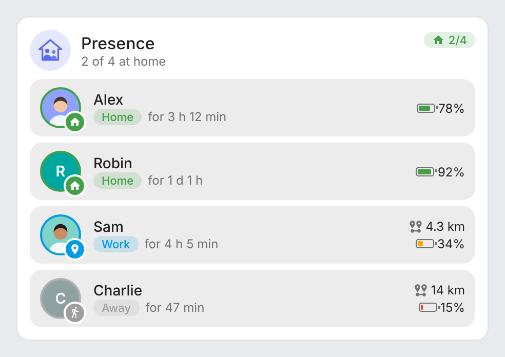
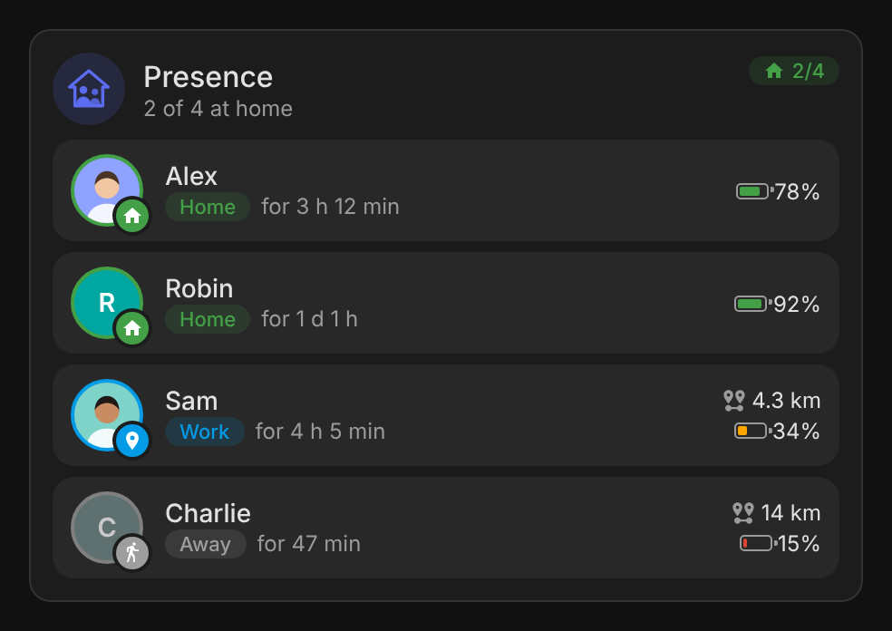
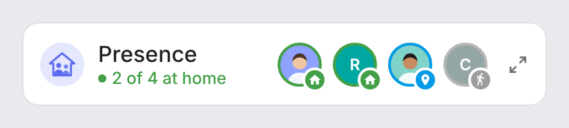
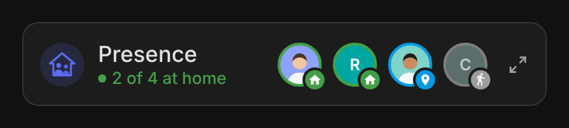
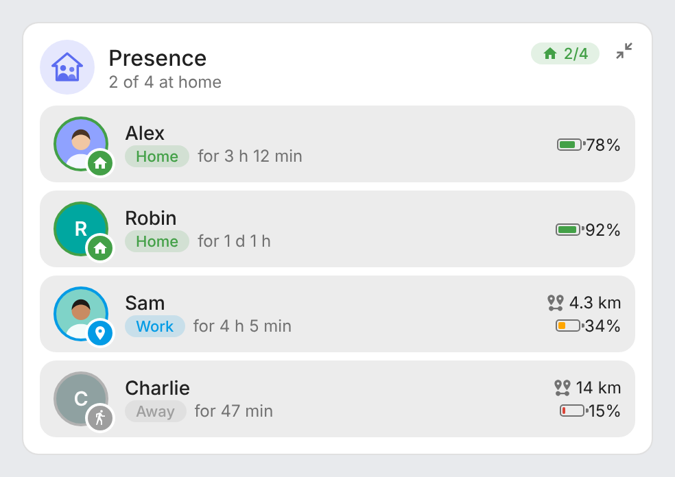
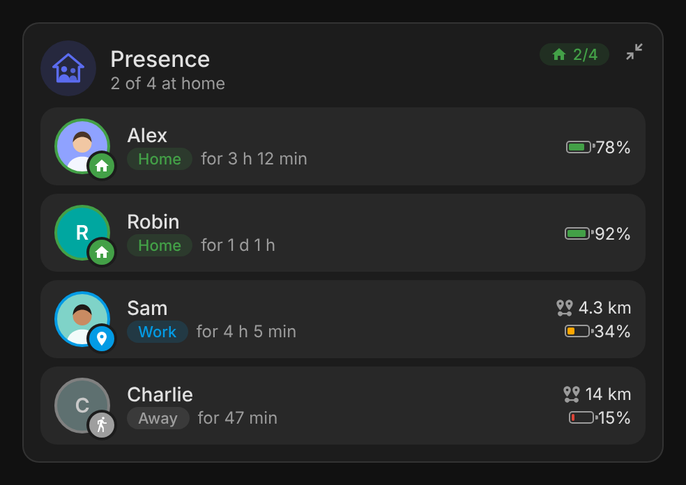

# ha-presence-card

[](https://github.com/hacs/integration)
[](https://github.com/juju35/ha-presence-card/actions/workflows/hacs.yml)
[](https://github.com/juju35/ha-presence-card/actions/workflows/validate.yml)
[](https://github.com/juju35/ha-presence-card/releases/latest)
[](LICENSE)

Lovelace cards for Home Assistant showing the people of the house and where they are: at home, in a zone or away, since when, how far from home and their phone battery.

The cards read the [`person`](https://www.home-assistant.io/integrations/person/) entities: no integration to install, every person is **found automatically**.

[](https://my.home-assistant.io/redirect/hacs_repository/?owner=juju35&repository=ha-presence-card&category=plugin)

| Presence Card | Presence Mini Card |
|---|---|
|  |  |

## Features

- Two cards: a full **Presence Card** and a compact **Presence Mini Card**
- Mini card on a single row, like the Alarm mini card: logo, title, summary in color and round avatars (name and place on hover); the avatars go under the title as soon as the title and summary would no longer fit in full next to them
- Zoom button at the top right of the mini card: it switches to the full card and back; a click anywhere outside the card brings the compact view back
- All `person` entities by default, or a chosen list, with an optional name or picture per person
- Person picture, or colored initials when the person has none
- Badge and color per state: home (green), zone (blue, with the zone name), away (grey), unknown (orange)
- How long each person has been there ("for 3 h 12 min"), refreshed every minute
- Distance from home for people away, in km or miles following the Home Assistant unit system
- Phone battery, found automatically: battery sensor of the tracker's device (Companion app) or the tracker's battery attribute; orange at 40 %, red at 20 %
- Header summary: "2 of 4 at home", "Everyone is home", "Nobody home"
- People at home first, by name, or as listed
- Click a person or a battery to open its more-info dialog
- Visual editor in the dashboard UI for both cards (no YAML needed)
- Light and dark mode, English and French
- Single file, no external dependency

## Prerequisites

Home Assistant 2024.8 or later, with people set up in **Settings → People** (each with a device tracker for the location).

## Installation

### Via HACS (recommended)

Click the button below to add the repository directly:

[](https://my.home-assistant.io/redirect/hacs_repository/?owner=juju35&repository=ha-presence-card&category=plugin)

Then click **Download**, and reload your browser when HACS asks you to.

Or manually:

1. Open HACS → **⋮** (top right) → **Custom repositories**
2. Add `https://github.com/juju35/ha-presence-card` — Type: **Dashboard**
3. Search for **Presence Card** and click **Download**
4. Clear your browser cache and refresh

### Manual

1. Download `presence-card.js` from the [latest release](https://github.com/juju35/ha-presence-card/releases/latest)
2. Copy it to `/config/www/presence-card.js`
3. Go to **Settings → Dashboards → ⋮ → Resources** → Add resource:
   - URL: `/local/presence-card.js`
   - Type: **JavaScript Module**
4. Clear your browser cache and refresh

## Configuration

### Visual editor

Edit a dashboard, click **Add card** and search for **Presence Card** or **Presence Mini Card**. Every person is shown by default; pick some in the list to restrict it, set an optional title, the order, what to display and the language. Options left at their default are kept out of the generated YAML.

### Minimal

```yaml
type: custom:presence-card
```

```yaml
type: custom:presence-mini-card
```

### Full options

```yaml
type: custom:presence-card
entities:
  - person.alex
  - entity: person.sam
    name: Sam
    picture: /local/sam.jpg
title: Family
sort: presence
show_since: true
show_distance: true
show_battery: true
show_away: true
language: fr
```

```yaml
type: custom:presence-mini-card
entities:
  - person.alex
  - person.sam
title: Family
sort: presence
show_away: true
zoom: true
language: fr
```

### Options reference

| Option | Card | Default | Description |
|---|---|---|---|
| `entities` | both | All people | People to show: `person` entity ids, or objects with `entity` and an optional `name` and `picture` |
| `title` | both | Presence | Card title |
| `sort` | both | `presence` | Order: `presence` (at home, then in a zone, then away), `name`, or `config` (as listed) |
| `show_since` | both | `true` | How long each person has been in their current state |
| `show_distance` | both | `true` | Distance from home for people away |
| `show_battery` | both | `true` | Phone battery |
| `show_away` | both | `true` | Show the people away (`false` keeps only people at home or in a zone) |
| `zoom` | mini | `true` | Zoom button at the top right: switches to the full card and back (`false` removes it) |
| `language` | both | Auto | Force language: `fr` or `en` (auto-detects from HA settings) |

`show_since`, `show_distance` and `show_battery` apply to the mini card once zoomed in.

## Screenshots

| Light | Dark |
|---|---|
|  |  |
|  |  |
|  |  |

## How it works

- **State**: `home` is at home, `not_home` is away, `unknown` / `unavailable` is unknown, any other state is the name of the zone the person is in.
- **Since**: the `last_changed` time of the person entity.
- **Distance**: great-circle distance between the person's `latitude` / `longitude` and `zone.home`.
- **Battery**: for each tracker of the person (the one in use first), the battery sensor of the same device (`sensor.*_battery_level` or `sensor.*_battery`, as created by the Companion app), else the tracker's `battery_level` / `battery` attribute.

## Development

```bash
npm install
npm run build        # bundles src/presence-card.js into dist/presence-card.js
npm run check        # builds and checks the card (run in CI)
npm test             # unit and browser tests
npm run screenshots  # renders the cards with mock data (scripts/mock-states.mjs) into screenshots/
```

`dist/` is not committed: `npm run build` creates it locally, CI builds it on every push, and the release workflow attaches the built file to the release, which is where HACS downloads it from.

### Releasing

1. Bump `version` in `package.json`
2. Add a `## <version>` section at the top of [CHANGELOG.md](CHANGELOG.md)
3. Push to `main`: the **Release** workflow builds the card, creates the tag and the GitHub release with the changelog section as notes, and attaches `presence-card.js`

## Translations

The cards auto-detect the language from your Home Assistant settings. Currently supported:

| Language | Code |
|---|---|
| English | `en` |
| Français | `fr` |

Contributions for additional languages are welcome!

## License

[MIT](LICENSE)
